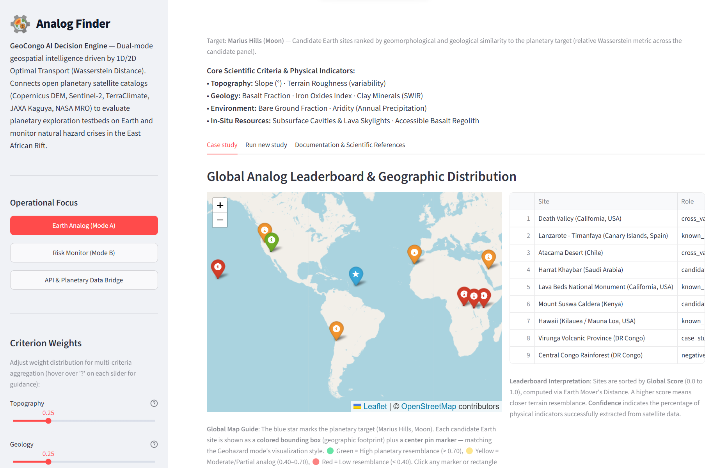

# Analog Finder


**GeoCongo AI** · NASA Space Apps Challenge 2026

## Live deployments

| Service | Link |
|---|---|
| Interactive dashboard | [analog.geocongoai.com](https://analog.geocongoai.com/) |
| Open Science REST API (Swagger) | [api.analog.geocongoai.com/docs](https://api.analog.geocongoai.com/docs) |
| ReDoc | [api.analog.geocongoai.com/redoc](https://api.analog.geocongoai.com/redoc) |



## Problem statement

> About the Challenge: Selecting future landing sites and lunar base locations depends on many factors, including topography, geology, environment, and available resources, to name a few. Places on Earth that have analogous characteristics to the Moon or Mars – the Atacama Desert, Haughton Crater, Death Valley – allow mission teams to test equipment and methods before they fly; however, such terrestrial analog sites are not entirely well characterized. Your challenge is to use open Earth, Moon, and Mars data from NASA and other space agencies to identify and characterize new terrestrial analogs for future bases or landing sites, drawing on deserts, polar regions, volcanic and arid terrains, caves, and other environments that share conditions with the lunar or Martian surface, then present your findings as a map, visualization, or other tool.

GeoCongo AI compares continuous terrain and environmental indicator distributions using one- and two-dimensional Wasserstein optimal transport ($W_1$). The open-source pipeline discovers and characterizes candidate sites from STAC data, then presents mapped comparisons in an interactive dashboard and REST API.

## Dual operational capabilities

| Track | Purpose |
|---|---|
| **A — Earth Analog (Moon & Mars)** | Characterize terrestrial analog candidates—including volcanic fields, deserts, lava tubes, and basalt quarries—against JAXA SELENE Kaguya lunar and NASA MRO Martian digital terrain models. |
| **B — East African Rift Geohazard Monitor** | Monitor landslide indicators in Bukavu and volcanic activity in Nyiragongo and Virunga through temporal change detection between baseline $T_0$ and observation $T_1$. |

## Open data pipeline

| Source | Data | Use |
|---|---|---|
| Copernicus DEM GLO-30 | Global elevation, 30 m | Earth topography and terrain derivatives |
| Sentinel-2 L2A | Multispectral imagery, 10–20 m | Bare ground, vegetation, and mineral indicators |
| TerraClimate | Climate and precipitation | Aridity and environmental context |
| JAXA SELENE Kaguya | Lunar terrain-camera DTMs | Lunar target topography |
| NASA MRO CTX / HiRISE | Martian terrain models | Mars target topography at CTX and HiRISE scales |

Earth collections are accessed through Microsoft Planetary Computer STAC; lunar and Martian collections use USGS Astrogeology STAC. Data products are open and accessed as Cloud-Optimized GeoTIFFs where available.

## Mathematical core

For one-dimensional distributions with quantile functions $F_P^{-1}$ and $F_Q^{-1}$, the Wasserstein-1 distance is:

$$W_1(P,Q)=\int_0^1\left|F_P^{-1}(u)-F_Q^{-1}(u)\right|\,du$$

The similarity transform is $S_i=\exp(-W_1/\sigma_i)$, where $\sigma_i$ is the scale for indicator $i$. For temporal monitoring, localized two-dimensional patch comparisons preserve the spatial pattern of change between $T_0$ and $T_1$.

## Quickstart

### Local dashboard

Requires Python 3.10 or later.

```bash
python3 -m venv .venv
source .venv/bin/activate
python -m pip install -r requirements.txt
python -m pip install -e .

# Generate offline demo inputs for both operational tracks
python -m analog_finder.pipeline --mode all --synthetic
streamlit run app/streamlit_app.py
```

### Docker Compose

```bash
docker compose up -d
```

Open the dashboard at [localhost:8501](http://localhost:8501), or the local API documentation at [localhost:8000/docs](http://localhost:8000/docs). The Compose ports bind to localhost.

## REST API examples

Search lunar terrain data around Marius Hills:

```bash
curl --fail-with-body \
  "https://api.analog.geocongoai.com/v1/planetary/search?body=moon&min_lon=-57&min_lat=13&max_lon=-55&max_lat=15&data_type=dem"
```

Analyze a terrestrial candidate against the lunar target:

```python
import requests

response = requests.post(
    "https://api.analog.geocongoai.com/v1/analyze",
    json={
        "mode": "analog",
        "site_id": "hawaii",
        "target_ref": {"target_id": "marius_hills"},
        "options": {"synthetic": True},
    },
    timeout=60,
)
response.raise_for_status()
print(response.json())
```

## Team and citation

Developed by **GeoCongo AI** for the **NASA Space Apps Challenge 2026**.

```bibtex
@software{geocongoai_analog_finder_2026,
  author       = {{GeoCongo AI}},
  title        = {Analog Finder},
  year         = {2026},
  url          = {https://github.com/BirushaNdegeya/analog-finder},
  note         = {NASA Space Apps Challenge 2026}
}
```
